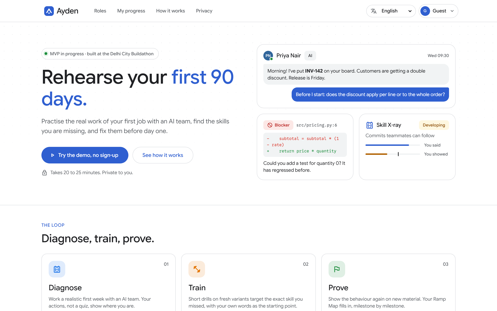
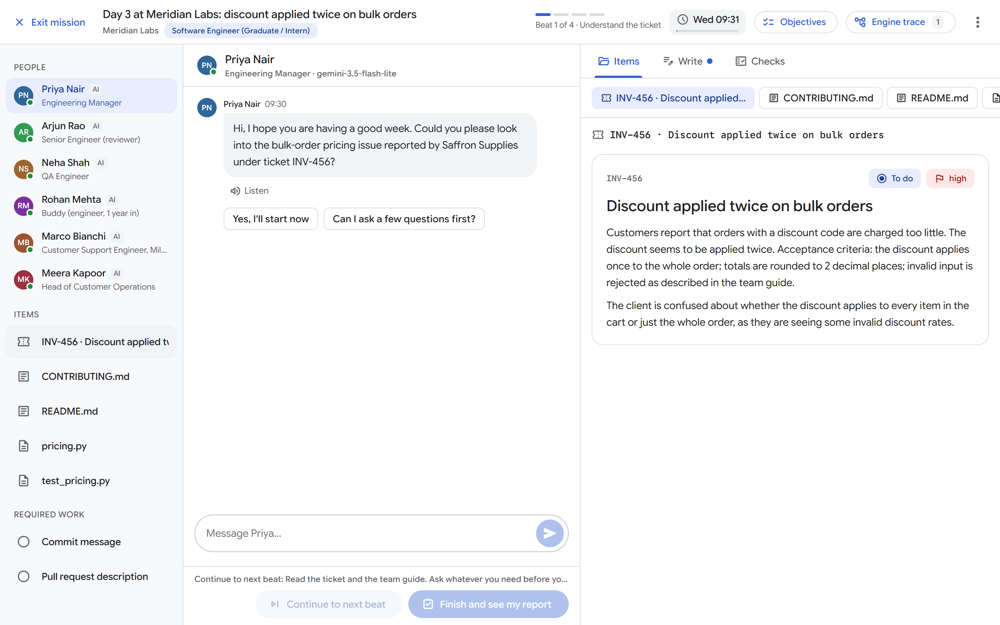
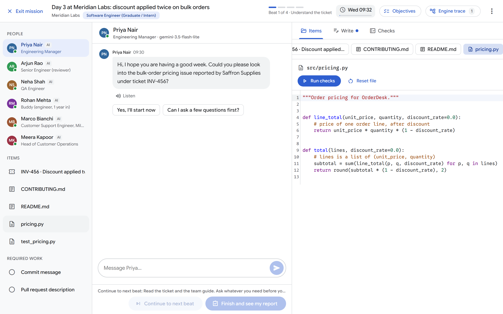
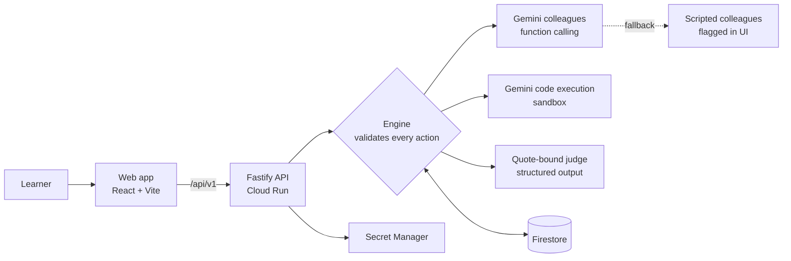
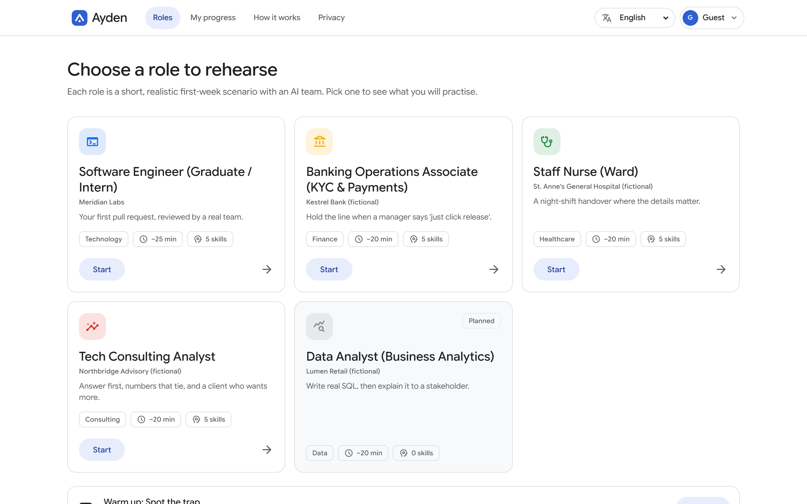
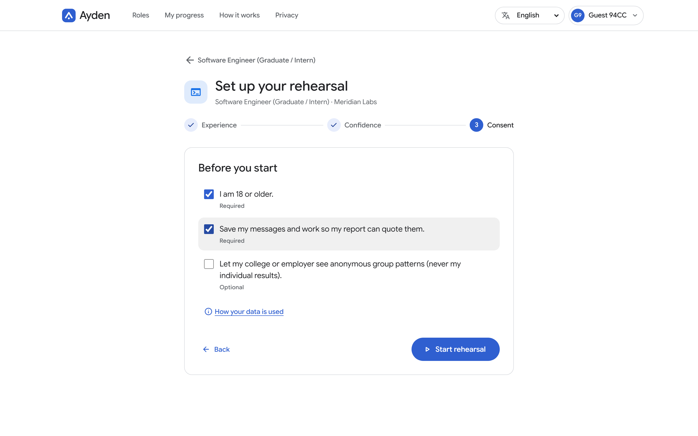
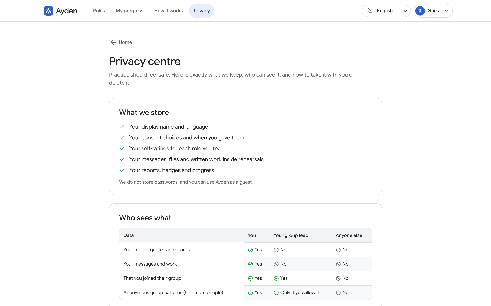
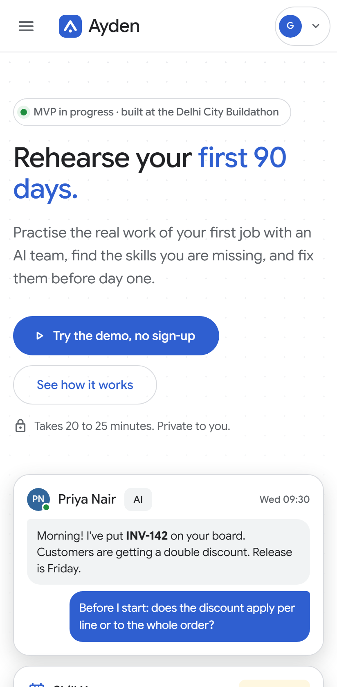
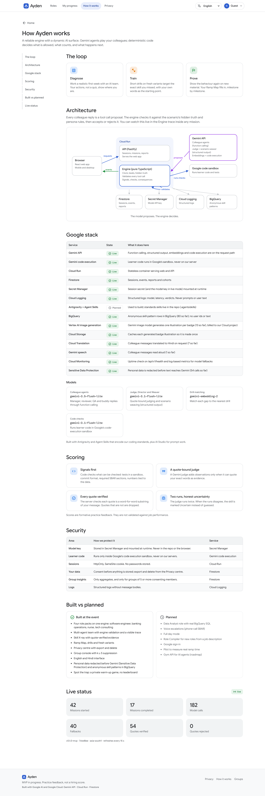

<div align="center">

# Ayden

### Rehearse your first 90 days.

Practise the real work of your first job with an AI team, find the skills you are missing, and fix them before day one.

[](https://ayden-app-388558128884.asia-south1.run.app)


**[Try the demo, no sign-up](https://ayden-app-388558128884.asia-south1.run.app)** · Takes 20 to 25 minutes · Private to you

Built at the **Startup Buildathon India 2026** (Google DeepMind + Google Cloud), Delhi City Buildathon, by **Team Ayden Times**.



</div>

---

## The problem

New graduates are judged on day-one work, but nobody lets them practise it. Interviews test answers. Courses test theory. Ayden lets you do a realistic working day, with colleagues who reply like real ones, and then shows you **which skills are lacking, with your own words as evidence**.

## How it works

1. **Pick a role.** Software Engineer, Banking Ops, Nurse or Tech Consulting.
2. **Work a realistic day** with a team of AI colleagues: manager, reviewer, QA, buddy, a senior stakeholder. Read the ticket, ask questions, write real code, commit, open a pull request, handle review feedback.
3. **Get a Skill X-ray.** Where you are strong, where you are lacking, how your self-rating compares with what you showed, and what to practise next.
4. **Drill the gap.** A short targeted drill or a new variant of the same scenario.

<p align="center">
  
</p>

<p align="center"><em>Day 3 at a fictional company: the manager has just handed over a ticket. Colleagues, items and required work on one screen.</em></p>

### Real work, checked for real

<p align="center">
  
</p>

Learner code runs in **Google's code-execution sandbox** (Gemini code execution), never on our server. If the sandbox is slow or unavailable, Ayden falls back to clearly labelled static checks and says so in the UI.

## The rule that keeps it honest

> **The model proposes. The engine decides.**

Every AI action is validated against the world state and each colleague's knowledge boundaries, and shown in a visible **Engine Trace**. Scores come from deterministic code signals first, then a judge whose quotes the server verifies against what you actually wrote. The judge runs twice and returns `uncertain` when the runs disagree.



## Screens

<table>
  <tr>
    <td width="50%"><br><sub><b>Role picker.</b> Four roles ready; Data Analyst is shown as planned.</sub></td>
    <td width="50%"><br><sub><b>Consent first.</b> Two required boxes; sharing group patterns is optional.</sub></td>
  </tr>
  <tr>
    <td width="50%"><br><sub><b>Privacy centre.</b> Export or delete your data any time.</sub></td>
    <td width="50%" align="center"><br><sub><b>Phone first.</b> Designed and tested at 360 px.</sub></td>
  </tr>
</table>

<details>
<summary><b>How it works page (full)</b></summary>



</details>

## What is built

| Area | State |
|---|---|
| Roles | Software Engineer, Banking Ops, Nurse, Tech Consulting ready; Data Analyst planned |
| Engine | Turn-based world, beats, scripted events, knowledge boundaries, commitment detection, validated tools, idempotent actions |
| Agents | Gemini function-calling colleagues; scripted fallback, flagged in the UI |
| Code checks | Run in Google's code-execution sandbox; labelled static fallback |
| Scoring | Code signals first, quote-bound judge second (server verifies every quote), two runs, `uncertain` on disagreement |
| Learner data | Consent, export, delete; progress, Ramp Map, evidence-linked badges |
| Cohorts | Join codes; anonymous patterns only for groups of 5 or more |
| Status | `GET /api/v1/system/status` reports which services are live, fallback or planned |

The honest list of what is built and what is planned: [docs/BUILT_VS_PLANNED.md](docs/BUILT_VS_PLANNED.md).

## Google technology

| Service | Used for |
|---|---|
| Gemini API | Colleague agents (function calling), judge and scenario weaver (structured output), embeddings |
| Gemini code execution | Learner code runs in Google's sandbox |
| Google AI Studio | API key |
| Cloud Run | One service hosts the API and the web app |
| Cloud Build + Artifact Registry | Deploy from source |
| Firestore | Sessions, events, reports |
| Secret Manager | Gemini key and session secret |
| Cloud Logging | Structured logs: model, latency, verdicts; never prompts or user text |
| BigQuery | Anonymous skill-pattern rows; no user ids or text |
| Sensitive Data Protection | Personal data redacted before text reaches Gemini |
| Vertex AI image generation + Cloud Storage | One illustration per badge, generated once and cached |
| Cloud Translation | Colleague messages translated on request |
| Gemini speech | Colleague messages read aloud |
| Cloud Monitoring | Uptime check on `/api/v1/health`, log-based metrics for model fallbacks |

Models in use: `gemini-3.5-flash-lite` (colleagues), `gemini-3.1-flash-lite` (judge, weaver, tester), `gemini-embedding-2`.

## Privacy and trust

- Your results are **private to you**. Colleges and employers see only anonymous patterns from groups of **5 or more**.
- **No leaderboards.** Ever.
- Feedback is **formative, not a hiring score**.
- Nurse and banking scenarios are **simplified, fictional training scenarios**, not clinical or compliance advice, and have not been reviewed by a clinician or compliance professional.

## Run it locally

```bash
npm install
cp .env.example apps/api/.env.local     # then edit; never commit it
npm run dev:api                         # http://localhost:8080 (scripted mode needs no key)
npm test                                # unit + end-to-end tests
npm run build && npm start              # production bundle: API + web on port 8080
BASE_URL=http://localhost:8080 npm run smoke
```

**Live Gemini mode:** set `LLM_MODE=live` and `GEMINI_API_KEY` (a free key from Google AI Studio) in `apps/api/.env.local`, then verify every model call:

```bash
node --env-file=apps/api/.env.local scripts/smoke-gemini.mjs
```

## Repository layout

```
apps/api           Fastify + TypeScript API, engine, agents, role packs
apps/web           React 19 + Vite web app
packages/contract  Shared API types (source of truth)
docs/              Architecture, security, integration, progress report
.agents/skills     Agent Skills (engineering standards, role-pack authoring)
```

## Docs

[Architecture](docs/ARCHITECTURE.md) · [Security](docs/SECURITY.md) · [Built vs planned](docs/BUILT_VS_PLANNED.md) · [Integration](docs/INTEGRATION.md) · [Integration notes](docs/INTEGRATION_NOTES.md) · [Progress report](docs/PROGRESS_REPORT.md) · [Contributing](CONTRIBUTING.md)

## Team

**Team Ayden Times** · Sai Mohit Kotta (frontend) · Tanish Shitanshu (backend, cloud)

<div align="center"><sub>MVP in progress. Built at the event.</sub></div>
